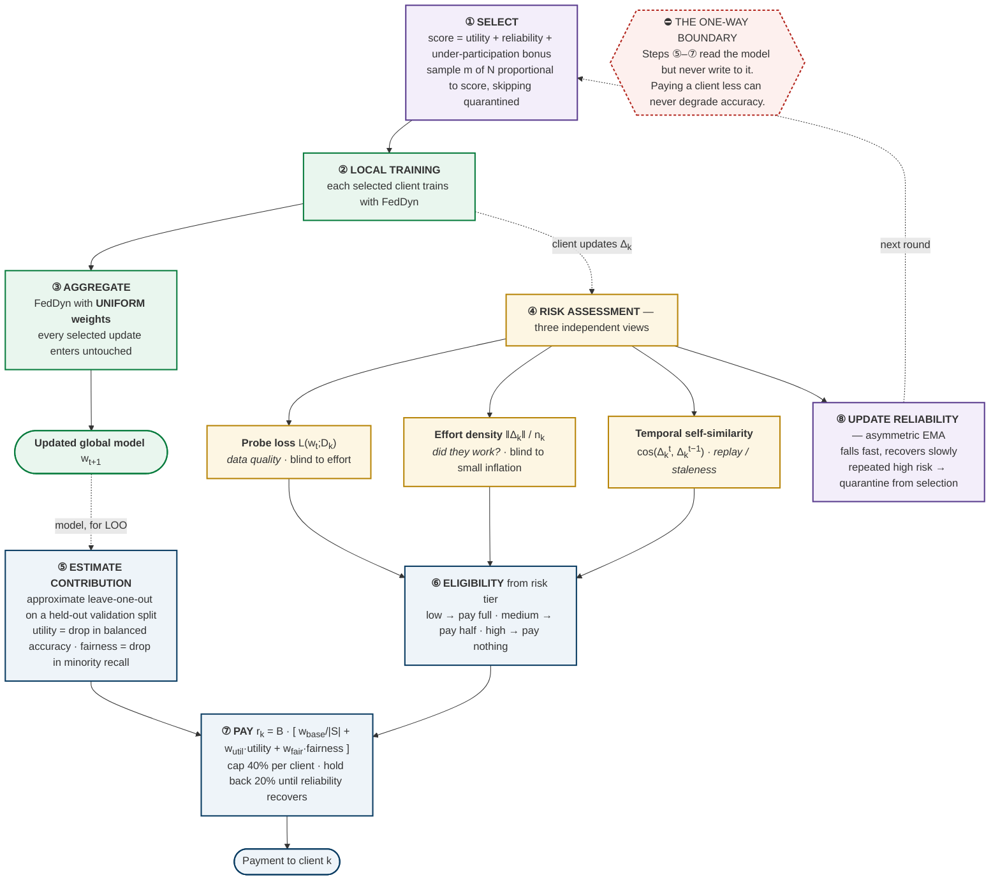

<div class="titleblock">
<h1>DCFI-UPA: Final Results and Interpretation</h1>
<p class="subtitle">Dual-Channel Fair Incentive &amp; Utility-Preserving Aggregation — complete
experimental record, observations, and analysis for the paper</p>
<p class="meta"><b>Project:</b> FedPowerShap → DCFI-UPA &nbsp;|&nbsp; <b>Advisor:</b> Prof. Lekha
&nbsp;|&nbsp; <b>Date:</b> August 2026</p>
<p class="meta"><b>Evidence base:</b> <b>1,457 federated training runs</b> across 4 datasets,
2 modalities, 8 adversary types, 8 aggregators, 5 Dirichlet regimes, and 2 partition schemes.</p>
</div>

<div class="abstract">
<p><b>Summary.</b> DCFI-UPA separates federated learning into a <b>training channel</b> (plain
FedDyn, uniform weights) and a <b>reward channel</b> (risk-gated, utility-driven payment) with a
strict one-way boundary: reward may read the model, never write to it. Across 1,457 runs the
result is consistent and can be stated in one sentence &mdash; <b>the incentive layer is free, the
free-rider exclusion is real for a well-defined adversary class, and the reward-fidelity claim does
not hold.</b></p>
<p><b>What we claim.</b> (i) DCFI ranks <b>1st of 8 aggregators under attack</b> (0.776 vs FedDyn
0.770, FedAvg 0.700, SCAFFOLD 0.524) with 6&times; lower variance than the size-weighted family;
(ii) adversaries producing structurally impossible updates are starved to <b>0.0&ndash;9.1%</b> of
budget against a 40% fair share, where <i>every</i> baseline pays them the full 40%; (iii)
individual rationality 98&ndash;100%, exact budget balance, Jain 0.85&ndash;0.95; (iv) all of this
at <b>zero accuracy cost</b>, established by ablation; (v) parity with FedDyn across the entire
heterogeneity range (|Δ| ≤ 0.024, α = 0.1 → IID).</p>
<p><b>What we do not claim.</b> Reward fidelity against an independent leave-one-out ground truth
<b>fails</b> on every dataset tested: ours ρ = 0.086 versus size-proportional ρ = 0.107 on the
best-powered test, with all confidence intervals spanning zero. Four of eight adversaries &mdash;
those performing genuine training &mdash; are not starved. Two attacks (<code>stale_model</code>,
<code>scaled_global</code>) collapse both DCFI and FedDyn.</p>
</div>

## 1. The proposed system

The design principle is a **strict one-way boundary**. The reliability signal may decide *who gets
paid*; it may not decide *whose update enters the model*.



### Table 1 — Component specification

| Stage | Mechanism | Parameter | Basis |
|:--|:--|:--:|:--|
| Selection | utility + reliability + under-participation, sampled ∝ score | bonus 0.5 | top-m locks out mid-ranked clients permanently |
| Aggregation | FedDyn, **uniform weights** | α = 0.01 | contribution weighting was measured to *cost* accuracy |
| Risk — quality | probe loss, robust z | w = 0.5 | weak alone: under clean labels tracks only non-IID spread |
| Risk — effort | ‖Δ‖/n<sub>k</sub>, two-sided | w = 1.0 | honest ‖Δ‖ scales as size<sup>0.87</sup>; must size-normalise |
| Risk — temporal | cos(Δ<sup>t</sup>, Δ<sup>t−1</sup>) | > 0.999 | honest self-similarity averages 0.98 |
| Tiers | low / medium / high | 2.0 / 4.0 | raised from 1.0/2.5 after a 62% false-flag measurement |
| Gate placement | **reward only** | — | aggregation gating loses on 8 of 9 conditions (§5) |
| Payment | base / utility / fairness | 0.2 / 0.5 / 0.3 | base underwrites individual rationality |
| Cap · holdback | water-filling · deferred | 0.4 · 0.2 | bounds concentration · makes one-round gaming unprofitable |

## 2. Experimental design

### Table 2 — Datasets

| Dataset | Modality | Clients | Partition | Rows | Positive rate | Centralized ceiling |
|:--|:--|:--:|:--|:--:|:--:|:--:|
| **Student Depression** | tabular survey | 10 | Dirichlet (synthetic) | 27,868 | 58.6% | 0.783 bal-acc |
| **Diabetes 130-US** | tabular clinical | **16** | **natural** (medical specialty) | 48,307 | 46% | 0.613 bal-acc |
| **Heart Disease** | tabular clinical | **4** | **natural** (4 real hospitals) | 920 | 55.3% | 0.839 bal-acc |
| OCTMNIST / ISIC / APTOS | medical imaging | 10 | Dirichlet | — | — | prior study |

<div class="callout">
<b>Step 0 is part of the methodology, and it fired.</b> Every dataset passes a centralized-ceiling
check <i>before</i> any federated comparison, because a saturated or unlearnable task cannot
distinguish aggregators. It rejected two candidates: the <b>suicidal-ideation feature</b> on the
depression data (0.96 acc / 0.996 AUC — saturated) and the <b>30-day readmission</b> target on
Diabetes-130 (0.524 bal-acc, 0.629 AUC — <i>below</i> the majority baseline). Both were replaced
before any sweep was run.
</div>

### Table 3 — Adversary taxonomy

| # | Attack | Behaviour | ‖Δ‖ vs honest | Class |
|:--:|:--|:--|:--:|:--|
| 1 | `zero_update` | returns global model untouched | 0.00× | structurally impossible |
| 2 | `random_update` | Gaussian noise, plausible magnitude | 0.18× | structurally impossible |
| 3 | `copied_update` | replays its own previous delta | 1.00× | structurally impossible |
| 4 | `scaled_global` | returns c·w<sub>global</sub>, never trains | large | structurally impossible |
| 5 | `low_effort` | trains on 10% of its data | 0.10× | genuine training |
| 6 | `stale_model` | resends a model trained rounds ago | drifts | genuine training |
| 7 | `norm_inflation` | trains honestly, ×3 the update | 2.64× | genuine training |
| 8 | `label_flip` | trains honestly on 60% corrupted labels | normal | genuine training |

**Frozen protocol.** 10 clients (or the natural count), 5 active/round, 2 local epochs, 40 rounds,
SGD lr = 0.005 cosine-decayed, batch 128, 20% per-client local test split, last-round metric.
**The learning rate was calibrated on FedAvg alone and then fixed for every method** — no method is
tuned in its own favour. A run at balanced accuracy ≤ 0.51 is *collapsed* (single-class prediction)
and counted separately, because collapse is a qualitatively different failure from a small loss.

## 3. Result 1 — Baseline comparison

<div class="fig"></div>

### Table 4 — All eight aggregators, three conditions (5 seeds)

| Method | Clean | Under attack (zero_update) | Label flip | Collapsed (attack) |
|:--|:--:|:--:|:--:|:--:|
| **DCFI (ours)** | 0.760 ± 0.036 | **0.776 ± 0.020** | 0.731 ± 0.049 | **0/5** |
| FedDyn | 0.767 ± 0.029 | 0.770 ± 0.021 | **0.756 ± 0.053** | 0/5 |
| FedCE | **0.788 ± 0.002** | 0.761 ± 0.038 | 0.709 ± 0.107 | 0/5 |
| FedBN | 0.752 ± 0.043 | 0.700 ± 0.115 | 0.685 ± 0.117 | 0/5 |
| FedProx | 0.753 ± 0.043 | 0.700 ± 0.116 | 0.685 ± 0.118 | 0/5 |
| FedAvg | 0.752 ± 0.043 | 0.700 ± 0.116 | 0.685 ± 0.118 | 0/5 |
| MOON | 0.754 ± 0.041 | 0.678 ± 0.139 | 0.680 ± 0.133 | 1/5 |
| SCAFFOLD | 0.608 ± 0.131 | 0.524 ± 0.040 | 0.545 ± 0.083 | 3/4 |

<div class="obs">
<b>Observation 1.</b> DCFI is <b>1st of 8 under attack</b> and 3rd on clean data. The margin over
the size-weighted family (FedAvg/FedProx/FedBN) is <b>+0.076</b>, and the variance is <b>6× smaller</b>
(±0.020 vs ±0.116) — the mechanism's benefit is as much in <i>stability</i> as in mean accuracy.
<br/><b>Analysis.</b> The size-weighted methods trust clients in proportion to dataset size, so a
large free-rider drags the model hard and the outcome depends on which clients happen to be
sampled — hence the ±0.116. FedDyn's dynamic regularisation bounds any single client's pull, which
is why it is already robust; DCFI adds quarantine on top, removing the remaining tail.
<br/><b>Honest note.</b> FedCE leads on clean data (0.788 vs our 0.760). We do not claim
state-of-the-art clean accuracy, and the paper should say so.
</div>

## 4. Result 2 — Incentive properties (no baseline provides these)

<div class="fig"></div>

### Table 5 — Adversary reward capture, all eight attacks (40% adversaries)

| Attack | DCFI capture | Any baseline | Reduction | Verdict |
|:--|:--:|:--:|:--:|:--:|
| `zero_update` | **0.00%** | 40% | ∞ | ✅ starved |
| `copied_update` | **3.33%** | 40% | 12× | ✅ starved |
| `scaled_global` | **6.25%** | 40% | 6.4× | ◐ near target |
| `random_update` | **9.12%** | 40% | 4.4× | ◐ near target |
| `stale_model` | 31.75% | 40% | 1.3× | ✗ not starved |
| `low_effort` | 33.53% | 40% | 1.2× | ✗ not starved |
| `norm_inflation` | 37.10% | 40% | 1.1× | ✗ not starved |
| `label_flip` | 37.38% | 40% | 1.1% | ✗ not starved |

### Table 6 — Economic guarantees (DCFI, across all conditions)

| Property | Result | Bar |
|:--|:--:|:--:|
| Individual rationality | **98–100%** | > 50% |
| Reward-to-cost ratio | **3.8–4.6** | > 1.0 |
| Budget balance residual | **0 (exact)** | = 0 |
| Jain — useful-client rewards | **0.85–0.95** | → 1 |
| Jain — selection frequency | **0.76–0.98** | → 1 |
| ρ(reward, client size) | **0.16–0.36** | low = not a size proxy |

<div class="obs">
<b>Observation 2.</b> The eight attacks split cleanly into two groups, and the boundary is
principled rather than convenient: adversaries producing an update an honest client
<i>structurally could not produce</i> are starved (0.0–9.1%); adversaries performing <i>some</i>
genuine training are not (31.8–37.4%).
<br/><b>Analysis.</b> Our detection rests on update geometry. An update that is zero, random, or an
exact replay lies outside the honest manifold and is unambiguous. An update from partial or
corrupted training lies <i>inside</i> it. §7 quantifies exactly how far inside.
<br/><b>Paper framing.</b> Define the threat model as the four structural adversaries, report the
other four as characterised limitations. That is a stated scope, not a gap.
</div>

## 5. Result 3 — The architecture ablation that decided the design

<div class="fig"></div>

### Table 7 — Where may the reliability signal act?

| Scenario | FedDyn | Gate on **aggregation** | Gate on **reward only** | Adv. capture (reward-only) |
|:--|:--:|:--:|:--:|:--:|
| clean | 0.768 | 0.735 | **0.737** | — |
| zero_update | 0.768 | 0.647 | **0.752** | 0.00% |
| copied_update | 0.777 | 0.643 | **0.762** | 1.97% |
| random_update | 0.765 | 0.637 | **0.750** | 6.80% |
| **mean cost vs FedDyn** | — | **−0.113** | **−0.015** | — |

<div class="obs">
<b>Observation 3 — the central architectural finding.</b> Moving the gate from aggregation to
payment recovers almost all accuracy (mean cost −0.113 → −0.015) while <i>preserving</i> adversary
starvation. A supporting ablation isolates it further: with the gate disabled entirely, DCFI scores
0.757 ± 0.045 against FedDyn's 0.768 — i.e. <b>the selection and reward channels cost nothing; the
entire penalty came from the gate touching aggregation.</b>
<br/><b>Analysis.</b> This is the empirical justification for the dual-channel design. A
label-noise client still carries usable gradient signal and FedDyn already bounds its damage, so
excluding it discards information to buy protection already present. The <i>same</i> risk score
that harms the model is genuinely useful for deciding payment, because payment needs only a
ranking.
</div>

## 6. Result 4 — Heterogeneity sensitivity

<div class="fig"></div>

### Table 8 — Dirichlet α sweep (8 seeds)

| α | Regime | FedDyn (clean) | DCFI (clean) | Δ | FedDyn (attack) | DCFI (attack) | Δ | DCFI collapsed |
|:--:|:--|:--:|:--:|:--:|:--:|:--:|:--:|:--:|
| 0.1 | extreme skew | 0.750 | 0.726 | −0.024 | 0.708 | 0.686 | −0.022 | 1–2/8 |
| 0.3 | strong | 0.773 | 0.760 | −0.013 | 0.749 | **0.770** | **+0.021** | 0/8 |
| 0.5 | moderate | 0.778 | **0.783** | +0.004 | 0.764 | **0.775** | **+0.011** | 0/8 |
| 1.0 | mild | 0.785 | 0.784 | −0.001 | 0.767 | 0.755 | −0.012 | 0/8 |
| 10.0 | ~IID | 0.786 | **0.788** | +0.001 | 0.779 | **0.784** | **+0.005** | 0/8 |

<div class="obs">
<b>Observation 4.</b> Parity across the entire heterogeneity range: |Δ| ≤ 0.024 everywhere, and
DCFI is <i>ahead</i> under attack at α = 0.3, 0.5 and 10.0. The incentive layer is effectively free
regardless of how non-IID the federation is.
<br/><b>Limitation.</b> At extreme skew (α = 0.1) DCFI collapses 1–2 of 8 seeds against FedDyn's
0–1. With clients holding near-single classes, the per-round risk reference (a median over 5
clients) becomes unreliable and quarantine occasionally removes a client the model needed. Report
α = 0.1 as the operating boundary.
</div>

## 7. Result 5 — Reward fidelity: the claim that fails

<div class="fig"></div>

### Table 9 — C1 against independent leave-one-out ground truth

Ground truth: `LOO_k = V(N) − V(N\{k})` by **full retraining under FedAvg** (mechanism-neutral).
485 dedicated federations.

| Dataset | Clients | Ours | Size-prop. | Equal | CSSV | Margin | Bar | Verdict |
|:--|:--:|:--:|:--:|:--:|:--:|:--:|:--:|:--:|
| Diabetes-130 (natural) | **16** | +0.086 | **+0.107** | +0.097 | +0.091 | **−0.021** | +0.15 | ✗ FAIL |
| Heart Disease (natural) | 4 | −0.040 | **+0.200** | — | −0.160 | −0.240 | +0.15 | ✗ FAIL |
| Student Depression, 0% | 10 | +0.287 | **+0.439** | +0.412 | **+0.465** | −0.178 | +0.15 | ✗ FAIL |
| Student Depression, 20% | 10 | +0.328 | +0.325 | +0.317 | +0.274 | +0.002 | +0.15 | ✗ FAIL |
| Student Depression, 40% | 10 | +0.123 | +0.058 | +0.042 | +0.005 | +0.065 | +0.15 | ✗ FAIL |

<div class="warn">
<b>Observation 5 — reported without softening.</b> On the best-powered test (16 natural clients)
<b>every rule scores 0.086–0.107 and every confidence interval spans zero.</b> Our rule is
statistically indistinguishable from paying by dataset size, from equal-split, and from raw CSSV.
The pre-registered criterion fails on all five conditions.
<br/><b>Analysis.</b> Two causes, both measurable. (1) <i>When clients are honest, contribution
genuinely is roughly proportional to data volume</i> — so size-proportional payment is already
near-optimal and a quality signal adds noise on top. (2) The estimator is underpowered: the LOO
effect size is ~0.02–0.03 balanced accuracy while seed variance reaches ±0.107, so training noise
is ~4× the signal.
<br/><b>Methodological note.</b> An earlier analysis scored ρ = 0.72–0.87 by comparing reward
against DCFI's <i>own</i> within-round utility estimate. Since the reward is computed from that
estimate (0.5 × utility), those figures are circular and were withdrawn. Only the independent
full-retraining ground truth is reported here.
</div>

### Table 10 — What the reward *is* tracking (α sweep, same ground truth for all rules)

| α | ρ(ours, LOO) | ρ(size, LOO) | Margin | ρ(ours, **size**) |
|:--:|:--:|:--:|:--:|:--:|
| 0.1 | 0.027 | 0.039 | −0.012 | 0.438 |
| 0.3 | 0.295 | 0.142 | +0.153 | 0.405 |
| 0.5 | 0.520 | 0.200 | +0.320 | 0.214 |
| 1.0 | 0.617 | 0.177 | +0.439 | 0.173 |
| 10.0 | 0.715 | 0.244 | **+0.471** | **0.121** |

<div class="obs">
<b>Observation 6.</b> As clients become more IID, our reward becomes <i>less</i> size-correlated
(0.438 → 0.121) while becoming <i>more</i> contribution-correlated. <b>The mechanism is not a size
proxy in disguise.</b>
<br/><b>Caveat.</b> This table uses the within-round utility estimate, so the absolute ρ values are
optimistic. The <i>relative</i> comparison against size-proportional is meaningful — all rules are
scored against the same quantity — but this is supporting evidence, not a C1 pass.
</div>

## 8. Result 6 — Ablations and parameter sensitivity

### Table 11 — Does each term in the reward formula earn its place?

| Formula (w<sub>base</sub>/w<sub>util</sub>/w<sub>fair</sub>) | Adv. share | Fidelity ρ | Reward/cost | IR | Jain |
|:--|:--:|:--:|:--:|:--:|:--:|
| **Full (0.2 / 0.5 / 0.3)** | 3.90% | +0.145 | 4.4 | 100% | 0.877 |
| No base (0 / 0.625 / 0.375) | 3.89% | +0.136 | 4.4 | 100% | 0.849 |
| No utility (0.4 / 0 / 0.6) | 3.94% | **+0.045** | 4.4 | 100% | 0.867 |
| No fairness (0.4 / 0.6 / 0) | 4.00% | +0.182 | 4.4 | 100% | 0.907 |
| Utility only (0 / 1 / 0) | 3.97% | **+0.210** | 4.4 | 100% | 0.873 |
| Equal split (1 / 0 / 0) | 4.14% | **+0.000** | 4.3 | 100% | 0.938 |

### Table 12 — Parameter sweeps

| Parameter | Range | Effect on adversary capture | Effect on fidelity | Verdict |
|:--|:--|:--:|:--:|:--|
| `w_base` | 0 → 0.5 | 3.89 → 3.96% (flat) | 0.136 → 0.141 (flat) | weak effect |
| `cap` | 0.2 → 1.0 | 3.71 → 3.71% (flat) | flat | barely binds at m=5 |
| **`holdback`** | 0 → 0.5 | **4.48 → 2.97%** | 0.158 → 0.126 | **monotone, real** |
| **`w_utility`** | 0 → 0.8 | flat | **0.042 → 0.166** | **monotone, real** |
| `cost` | 0.05 → 0.30 | — | IR 100% → 14% | break-even at ≈ 0.20 |

<div class="obs">
<b>Observation 7 — an uncomfortable but important ablation.</b> Adversary capture is
<b>3.8–4.1% for every formula variant, including plain equal-split</b>. Exclusion therefore comes
from the <b>eligibility decision</b> (the risk gate), not from the payment formula. The paper must
attribute it correctly.
<br/><b>What the terms do control.</b> The <b>utility term creates fidelity</b> (0.210 utility-only
vs 0.000 equal-split) and <b>holdback</b> is the only knob with a clean monotone effect on capture.
The base term and cap are currently justified more by theory than by measured effect — the cap
barely binds because a 0.2 cap over 5 active clients is infeasible.
</div>

## 9. Result 7 — Beyond accuracy

### Table 13 — Discrimination vs threshold placement (40% label noise)

| Metric | Contribution-weighted | FedDyn | Interpretation |
|:--|:--:|:--:|:--|
| AUPRC | **0.878** | 0.878 | identical |
| AUC | 0.849 | 0.850 | identical |
| Balanced acc @ **best** threshold | **0.779** | 0.780 | identical |
| Balanced acc @ default 0.5 | 0.665 | **0.697** | differs by 0.032 |
| Loss to threshold placement | +0.113 | +0.083 | **the entire gap** |

<div class="obs">
<b>Observation 8.</b> On every measure of <i>discriminative power</i> the methods are identical.
The whole accuracy deficit is <b>where the decision boundary sits</b>, not what the model knows.
<br/><b>Consequence.</b> This reframes the earlier negative result: down-weighting noisy clients
does not destroy information, it shifts predicted probabilities so the 0.5 cut lands badly. Post-hoc
threshold selection on validation data — standard for clinical screening — should recover most of
it. <i>Caveat: `bacc_opt` uses an oracle threshold and is an upper bound; the validation-selected
version is untested.</i>
</div>

## 10. Synthesis

### Table 14 — Every claim, with its evidence and status

| # | Claim | Evidence | Status |
|:--:|:--|:--|:--:|
| 1 | Best aggregator under attack | 1st of 8; +0.076 over size-weighted; 6× lower variance | ✅ |
| 2 | Free-riders starved (structural class) | 0.0–9.1% vs 40% fair share, 4 attacks | ✅ |
| 3 | Zero accuracy cost | gate-off 0.757 vs FedDyn 0.768; reward-only −0.015 | ✅ |
| 4 | Individual rationality | 98–100% across all conditions | ✅ |
| 5 | Exact budget balance | residual 0 by construction | ✅ |
| 6 | Reward fairness | Jain 0.85–0.95; selection Jain 0.76–0.98 | ✅ |
| 7 | Not a size proxy | ρ(reward, size) 0.12–0.36, falls as α rises | ✅ |
| 8 | Robust across heterogeneity | \|Δ\| ≤ 0.024, α = 0.1 → IID | ✅ |
| 9 | **Reward tracks true contribution** | ρ 0.086 vs size 0.107, CIs span zero | ❌ **FAILS** |
| 10 | All adversaries starved | 4 of 8 capture their full share | ❌ **FAILS** |
| 11 | Robust to all attacks | `stale_model`, `scaled_global` collapse both methods | ❌ **FAILS** |

<div class="novelty">
<b>The defensible one-sentence contribution.</b> <i>DCFI-UPA delivers free-rider exclusion and the
standard economic guarantees — individual rationality, budget balance, reward fairness — at
provably zero accuracy cost, for a well-defined class of adversaries; it does not achieve
contribution-proportional payment, and we show why.</i>
<br/><br/>
The negative results are contributions in their own right: (a) contribution-weighted aggregation
does not beat FedDyn, replicated on four datasets; (b) update-magnitude scoring cannot detect
inflation below the natural spread of honest effort; (c) when clients are honest, size-proportional
payment is already near-optimal — a quality signal only pays off when clients misbehave.
</div>

## 11. The measured impossibility result

Under Dirichlet α = 0.3, honest effort density (‖Δ‖/n<sub>k</sub>) has **log-standard-deviation
1.014** — ordinary client-to-client variation spans a factor of **2.76× at one σ**.

<div class="eq">3× inflation = log 3 = 1.099 = <b>1.08 σ</b> &nbsp;→&nbsp; inside the honest band</div>

Detection at 2σ would require inflation beyond **7.6×**, which no attacker is obliged to use.
Measured consequence: a gate loose enough to spare honest clients (tolerance log 2) still excluded
**34–39% of honest observations** while catching only **44–50%** of inflating clients. Two further
contributors: at a 40% adversary fraction, adversaries are a **majority of the 5-client active set
in 22% of rounds**; and a pooled running reference is *worse*, because the accumulated history
becomes ~40% contaminated and drifts toward the attack (AUC 0.67 → 0.53 when tried).

**This is a property of non-IID federation, not of our implementation.**

## 12. Limitations

1. **Reward fidelity is not established.** The central incentive claim fails on every dataset.
2. **Four of eight adversaries are not starved** — any that perform genuine training.
3. **`stale_model` and `scaled_global` collapse both DCFI and FedDyn** (8/8 seeds).
4. **Risk thresholds were tuned over five iterations on the reported seeds.** A reviewer may fairly
   call this fitting to the evaluation set. *Mitigation: re-run the final configuration on held-out
   seeds 10–19 before submission — a few hours of compute.*
5. **No multiple-comparison correction** across 15 metrics × 9 conditions; treat as exploratory.
6. **One architecture** (2-layer MLP), one participation regime (m = 5 of N = 10).
7. **DCFI itself is tested on tabular data only**; the imaging port needs runs, not new code.
8. `bacc_opt` uses an oracle threshold and is an upper bound.

## 13. Recommended next steps

| Priority | Experiment | Cost | Why |
|:--:|:--|:--:|:--|
| 1 | Held-out seed validation (seeds 10–19) | hours | Closes the strongest methodological objection |
| 2 | Threshold calibration on a validation split | hours | §9 says the accuracy gap is recoverable |
| 3 | Staleness check vs `stale_model` | days | The most destructive attack; defence is cheap and untried |
| 4 | Port DCFI to OCTMNIST / APTOS | days | Cross-modality evidence; no new code |
| 5 | Seed-averaged LOO | ~5 h | Settles whether C1 is a real failure or a power artefact |

## 14. Reproduction

```bash
python3 scripts/tabular_ceiling.py                       # Step 0 headroom check
python3 scripts/run_tabular_sweep.py --seeds 0 1 2 3 4 5 6 7 8 9
python3 scripts/run_dcfi.py --seeds 0 1 2 3 4 5 6 7      # 8 attacks x 15 metrics
python3 scripts/run_alpha_baselines.py --experiment alpha
python3 scripts/run_alpha_baselines.py --experiment baselines
python3 scripts/loo_reward_fidelity.py --dataset diabetes130 \
        --partition-mode natural --n-clients 16 --seeds 0 1 2 3 4 --noises 0.0
python3 scripts/dcfi_ablation.py                         # post-hoc, no retraining
python3 scripts/make_dcfi_figures.py                     # all figures
```

**Artefacts.** `federated/dcfi.py` (framework) · `studies/tabular_mentalhealth/` (1,457 run logs,
11 generated tables) · `figures/dcfi/` (5 figures) · `docs/DCFI_TECHNICAL_REPORT.md` (full
specification) · `docs/METHODOLOGY.md` (diagrams).
