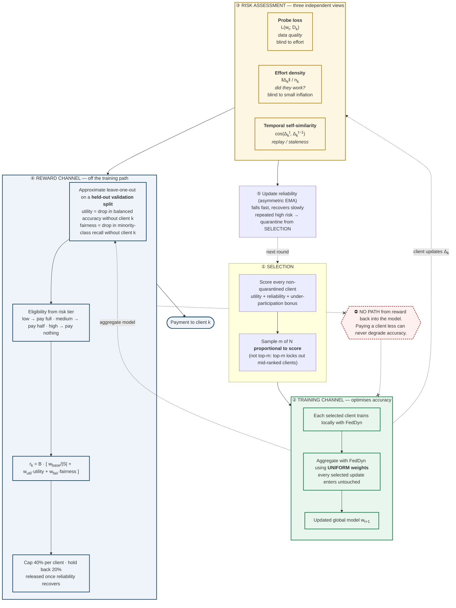
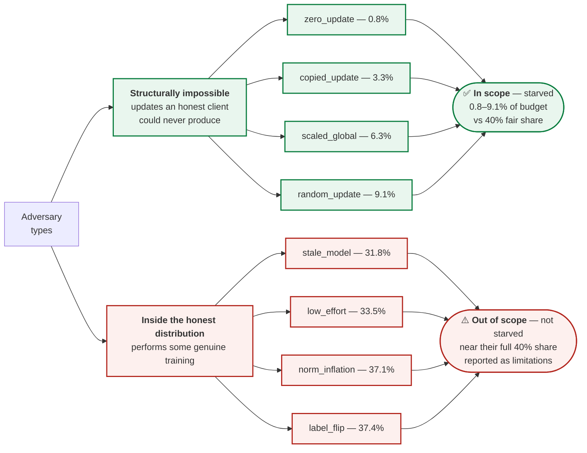
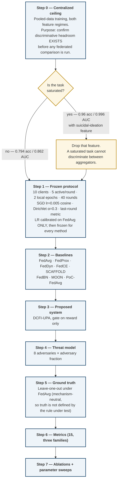

# DCFI-UPA — proposed methodology and dataset coverage

Companion to [`DCFI_TECHNICAL_REPORT.md`](DCFI_TECHNICAL_REPORT.md). The diagrams
below render natively on GitHub.

---

## 1. The proposed system: one communication round

The design principle is a **strict one-way boundary**. The reliability signal may
decide *who gets paid*; it may not decide *whose update enters the model*. That
separation is what makes the incentive layer free of accuracy cost — it was
measured, not assumed (see §4 and the technical report §9.3).

### Why the boundary is one-way

Our earlier method let the contribution signal set **aggregation weights**. A
controlled ablation showed the better that signal worked, the *worse* the model
became: the variant that detected nothing matched FedDyn (0.695 vs 0.697), and
the variant that detected well lost 0.030. A label-noise client still holds
usable gradient signal, and FedDyn's dynamic regularisation already bounds its
damage — so down-weighting discards information for protection already present.

Measured effect of moving the gate (5 seeds, balanced accuracy):

| Scenario | FedDyn | Gate on **aggregation** | Gate on **reward only** |
|:--|:--:|:--:|:--:|
| clean | 0.768 | 0.735 | **0.737** |
| zero_update | 0.768 | 0.647 | **0.752** |
| copied_update | 0.777 | 0.643 | **0.762** |
| random_update | 0.765 | 0.637 | **0.750** |

Adversary reward capture under reward-only gating stays at 0.00% / 1.97% / 6.80%
against a 40% fair share.

---

## 2. Threat model

The split is not arbitrary and it is not a convenience. An adversary that does
*some* real training produces an update lying inside the natural spread of
honest behaviour, and §7.6 of the technical report quantifies why that is
unfixable by magnitude scoring: honest effort density has log-sd 1.014, so a 3×
inflation sits 1.08 sd inside normal variation. Separating at 2 sd would demand
inflation beyond 7.6×, which no attacker is obliged to use.

---

## 3. Experimental methodology

### The fifteen metrics

| Performance | Reward fairness | Fairness |
|:--|:--|:--|
| balanced accuracy | Spearman ρ(reward, LOO) | Jain — useful-client rewards |
| macro-F1 | reward–contribution MAE | worst-client balanced accuracy |
| AUC | reward share, positive vs negative contributors | selection-frequency Jain |
| convergence rounds | reward-to-cost ratio | ρ(reward, client size) |
| collapsed seeds | individual-rationality rate | minority-class recall |

---

## 4. Datasets tried

### Used in reported results

| Dataset | Modality | Task | Runs | Where it appears |
|:--|:--|:--|:--:|:--|
| **Student Depression** (Kaggle `hopesb`, 27,901 rows) | tabular survey | binary depression screening, 58.6% positive | **869** | **Primary — all current DCFI-UPA results** |
| **OCTMNIST** | retinal OCT | 4-class | 38 | Earlier robustness study; the CSSV negative result |
| **ISIC / DermaMNIST** | dermoscopy | 7-class | 20 | Cross-dataset generalisation |
| **APTOS-2019** | fundus photography | 5-class ordinal (QWK) | 20 | Cross-dataset generalisation |
| **Depression Student** (Kaggle `ikynahidwin`, 502 rows) | tabular survey | binary | ceiling only | Saturation check — showed 0.96 acc / 0.996 AUC with the suicidal-ideation feature, which is why the screening regime exists |

**Coverage: 4 datasets across 2 modalities with full federated results**, plus one
used as a saturation control. The core negative result (contribution-weighted
aggregation does not beat FedDyn) replicates on all four.

### Present in the codebase, not used for results

`chestxray14` (2 exploratory runs only), `cifar10`, `mnist`, `fmnist`, `brats` —
loaders exist and work, but none are part of any reported study.

### Why the tabular mental-health dataset is primary

- Matches the incentive setting: small institutional cohorts, self-reported and
  therefore noisy labels, genuine privacy motivation.
- Cheap enough to run 864 federations — the leave-one-out ground truth alone
  needs 390, which is infeasible on ResNet-scale imaging.
- Non-saturated in the screening regime, so aggregators are actually
  distinguishable (verified in Step 0 before any comparison was run).

### Honest limitation

All current DCFI-UPA results are on **one dataset**. The earlier negative result
is 4-dataset; the incentive mechanism is not yet. Porting DCFI to OCTMNIST or
APTOS is the clearest way to strengthen external validity, and the code path is
dataset-agnostic — it needs runs, not new implementation.
